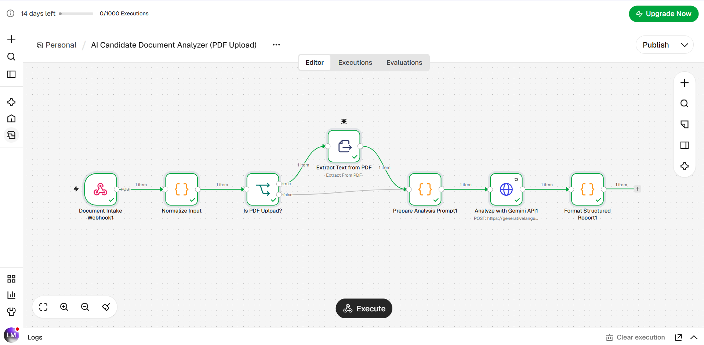

# AI Candidate Document Analyzer

An **n8n** automation that turns a candidate's CV (PDF upload or plain text) into a structured, evidence-based screening report using the **Google Gemini API**.

Built to show how AI can speed up first-round HR screening **without** making hiring decisions: the workflow summarizes and organizes what is in the CV, flags missing information, and suggests follow-up questions. It never ranks, accepts or rejects candidates.



## Features

- **Two input modes:** upload a CV as a PDF (`multipart/form-data`) or send extracted text as JSON
- **PDF text extraction** with n8n's built-in Extract from File node
- **Structured JSON output:** summary, skills, experience highlights, education, missing information, follow-up questions
- **Responsible AI safeguards:**
  - Treats the document as untrusted input (resistant to prompt injection)
  - Uses only information present in the CV; no invented qualifications
  - Does not infer protected characteristics or rank candidates
- **Reliability:** input validation, file-type checks, text cleaning, 30k-character limit, retries on failure

## How it works

```
Webhook → Normalize Input → Is PDF Upload?
                               ├─ yes → Extract Text from PDF ─┐
                               └─ no  ─────────────────────────┤
                                                               ▼
                         Prepare Analysis Prompt → Gemini API → Format Structured Report
```

| Node | Purpose |
|------|---------|
| Document Intake Webhook | Receives a POST request with a PDF or text |
| Normalize Input | Validates input and detects whether a PDF was uploaded |
| Is PDF Upload? | Routes PDFs to text extraction |
| Extract Text from PDF | Pulls text out of the uploaded CV |
| Prepare Analysis Prompt | Cleans text and builds a safe, structured prompt |
| Analyze with Gemini API | Calls Gemini with JSON output mode |
| Format Structured Report | Parses the response and adds metadata |

## Setup

1. Get a free Gemini API key from [Google AI Studio](https://aistudio.google.com/apikey).
2. In n8n, go to **Workflows → Import from File** and select `workflow/candidate-document-analyzer.json`.
3. Open the **Analyze with Gemini API** node and select or create a **Google Gemini (PaLM) API** credential with your key.
4. Click **Execute workflow** to test, or activate the workflow for production use.

## Usage

**Upload a PDF** (Windows PowerShell / any terminal with curl):

```bash
curl -X POST "https://YOUR-N8N-INSTANCE/webhook/candidate-document-analyzer" \
  -F "candidate_name=Ayesha Khan" \
  -F "cv=@samples/sample_cv.pdf;type=application/pdf"
```

**Send plain text:**

```bash
curl -X POST "https://YOUR-N8N-INSTANCE/webhook/candidate-document-analyzer" \
  -H "Content-Type: application/json" \
  -d '{"candidate_name":"Ayesha Khan","document_text":"Software Engineer, 3 years Python..."}'
```

More test cases are in [`tests/test-requests.ps1`](tests/test-requests.ps1).

## Example output

```json
{
  "status": "success",
  "input": { "source": "pdf_upload", "file_name": "sample_cv.pdf", "characters_analyzed": 812, "truncated": false },
  "analysis": {
    "candidate_name": "Ayesha Khan",
    "professional_summary": "Software engineer with 3 years of experience building backend APIs...",
    "skills": ["Python", "Django", "PostgreSQL", "Docker", "AWS", "n8n"],
    "experience_highlights": ["Led migration of 12 services to AWS, cutting hosting costs by 30%"],
    "education": ["BS Computer Science, FAST NUCES, 2021"],
    "missing_or_unclear_information": ["No certifications listed"],
    "follow_up_questions": ["Can you describe your role in the AWS migration?"]
  }
}
```

## Limitations and next steps

- Scanned (image-only) PDFs have no extractable text; OCR support is a planned improvement.
- n8n Cloud webhooks time out after about 100 seconds, so very slow model responses may need an asynchronous design.
- Planned: web upload form (n8n Form Trigger), saving results to Google Sheets, and batch processing.

## Tech stack

n8n · Google Gemini API · JavaScript (n8n Code nodes) · REST / Webhooks

## Author

**Laiba Mir** · [LinkedIn](https://linkedin.com/in/laiba-mir-6b363924a) · [GitHub](https://github.com/LaibaMir1)
